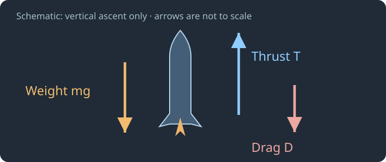
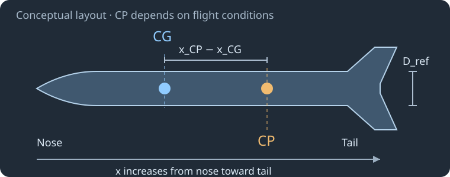
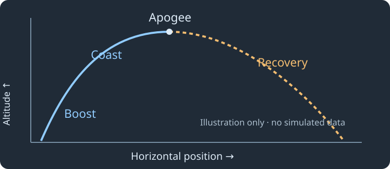

# `The science behind it` — العلم وراء تصميم الصاروخ ومحاكاة رحلته

هذا مقال تعليمي بالعربية، مع إبقاء المصطلحات العلمية وأسماء الحقول بالإنجليزية. يشرح لماذا تؤثر اختياراتك في Hoshi في الرحلة، وكيف تفسر النتائج. إنه مراجعة للمبادئ والنموذج المستخدم، وليس بحثاً يقدم قياسات جديدة أو شهادة بصلاحية إطلاق صاروخ معين.

## 1. من الرسم إلى نموذج فيزيائي

عندما تضيف Body tube أو Fins، فأنت لا تضيف شكلاً على الشاشة فقط. تصف هندسة لها طول وحجم وكتلة وموقع، وتتفاعل مع الهواء. وعندما تختار Motor، تضيف قوة دفع تتغير مع الزمن وكتلة تتناقص مع استهلاك الوقود. أما Flight controls فتحدد البيئة التي يجري داخلها الحساب.

Hoshi يجمع هذه المدخلات ويستخدم محرك OpenRocket 24.12 المثبت لحساب الحركة. المهم هنا أن المحاكاة تجيب عن سؤال محدد: ماذا يتوقع هذا النموذج إذا كانت هذه المدخلات والافتراضات صحيحة؟ لا يستطيع البرنامج معرفة كمية الغراء الفعلية أو الريح في موقعك ما لم تمثلها في المدخلات.

لذلك تتكون الرحلة الموثوقة من سلسلة مترابطة: هندسة تصف البناء، وقياسات تصف كتلته وتوازنه، وبيانات تصف المحرك، وظروف تصف الجو، ثم مقارنة للتوقعات مع الواقع. نجاح خطوة واحدة لا يعوض خطأً كبيراً في خطوة أخرى.

## 2. القوى: لماذا يصعد الصاروخ أو لا يصعد؟

المبدأ الأساسي هو قانون نيوتن الثاني Newton’s second law: محصلة القوى تسبب تغير الحركة. في حالة مبسطة جداً، لصاروخ يصعد عمودياً في هواء ساكن، يمكن كتابة:

`a = (T − D − m g) / m`

هنا T قوة الدفع Thrust بوحدة N، وD قوة مقاومة الهواء Drag، وm الكتلة اللحظية بوحدة kg، وg تسارع الجاذبية. هذه معادلة لفهم مرحلة الصعود المبسطة؛ في المسار الحقيقي توجد اتجاهات وحركة جانبية ودوران، كما أن اتجاه مقاومة الهواء يتبع الحركة النسبية للهواء. لا تستعمل إشارة −D نفسها آلياً لوصف كل اتجاه وكل مرحلة هبوط.

إذا كان الدفع غير كافٍ لمغادرة الدليل، فلن ينقذ التصميمَ ارتفاعٌ متوقع من حالة أخرى بمحرك مختلف. وإذا كان الدفع كبيراً، فقد تصبح الأحمال والتسارع ومغادرة الدليل هي القضايا الأهم. لا توجد قيمة دفع واحدة مناسبة لكل صاروخ؛ يجب تقييم القوة مع الكتلة ودليل الإطلاق والريح والاستقرار.

في مرحلة Coast ينتهي الدفع، لكن الصاروخ لا يتوقف فوراً؛ يكون قد اكتسب سرعة وطاقة حركية. تستمر الحركة بينما تغير الجاذبية والهواء السرعة والاتجاه. وعند Apogee تصل الإزاحة الرأسية إلى قمتها، وقد تبقى للصاروخ سرعة أفقية.

## 3. منحنى الدفع والنبضة الكلية

ينشأ الدفع من تبادل الزخم Momentum بين الصاروخ والغاز الذي يطرحه المحرك. لا يحتاج الصاروخ إلى دفع الهواء الخارجي كي يعمل؛ الفكرة هي قذف كتلة في اتجاه والحصول على استجابة في الاتجاه المقابل. قوة الدفع على الصاروخ ورد فعل الصاروخ على الغاز يؤثران في جسمين مختلفين، فلا تلغي إحداهما الأخرى على الصاروخ نفسه.

منحنى Thrust curve يربط قوة الدفع بالزمن. أما Total impulse فهي المساحة تحت المنحنى:

`I = ∫ T(t) dt`

الدفع يقاس بالنيوتن N، والنبضة الكلية بالنيوتن·ثانية N·s. محركان لهما النبضة نفسها لا يلزمان بإنتاج التسارع نفسه؛ قد يعطي أحدهما دفعاً أعلى في البداية ومدة احتراق أقصر، بينما يوزع الآخر الدفع على فترة أطول. لهذا لا يكفي اختيار محرك اعتماداً على رمز أكبر أو نبضة أعلى فقط.

عند بداية الإطلاق تكون استجابة الصاروخ مرتبطة بالدفع المبكر وبالكتلة المحمّلة وبطول الدليل. وخلال الاحتراق تتغير الكتلة ومركز الثقل وعزم القصور مع توزيع الوقود والمحرك. يتعامل نموذج المحرك مع هذا التغير بحسب بياناته؛ أما استيراد ملف .eng أو .rse فلا يثبت وحده أن بياناته صحيحة أو مناسبة للمحرك الموجود فعلياً.

في نموذج مثالي بسرعة عادم فعالة ثابتة، ومن دون فقد الجاذبية والمقاومة، تربط Rocket equation تغير السرعة بنسبة الكتلة: `Δv = v_e ln(m_initial / m_final)`. لكنها ليست معادلة تعطي ارتفاع الرحلة مباشرةً؛ المسار الفعلي يحتاج حساب القوى والاتجاه والزمن، وهو ما يفعله نموذج الطيران.

الشرح هنا يفترض محركات تجارية مصنّعة وبيانات موثقة. المحاكاة لا تصمم وقود المحرك ولا تختبر عيوب احتراقه أو جودة تثبيته المادية.

## 4. الأبعاد والمواد: لماذا ليست Density هي Strength؟

في قطعة متجانسة، ترتبط الكتلة بالكثافة والحجم عبر العلاقة `m = ρ_material × Volume`. زيادة سماكة أنبوب مع ثبات بقية الأبعاد تزيد عادةً حجم المادة وكتلتها. وهذا يؤثر في التسارع والتوازن وفي حمل نظام الاسترجاع، وليس في شكل الرسم وحده.

لكن الكثافة Density لا تصف مقاومة الكسر Strength أو الصلابة Stiffness. قد تكون مادتان متقاربتين في الكثافة ومختلفتين جداً في سلوك الانحناء والحرارة والتعب. كما قد يفشل اتصال الزعنفة بالبدن قبل أن تفشل المادة نفسها.

خصائص مثل معامل المرونة Elastic modulus، واتجاه ألياف المادة، وشكل الوصلة، وجودة البناء، تؤثر في الأحمال الممكن تحملها. وبالنسبة للزعانف، قد ينتج Flutter من اقتران المرونة بالحركة الهوائية. تغيير خانة Material في Hoshi يساعد في حساب الكتلة؛ لا يمثل اختباراً مفصلاً لهذه الظواهر.

لذلك ينبغي التفريق بين سؤالين: هل النموذج يتوقع مساراً مقبولاً؟ وهل البنية الحقيقية تستطيع تحمل الأحمال خلال ذلك المسار؟ الإجابة عن الأول لا تثبت الثاني.

## 5. الكتلة والتوازن: CG وMoment of inertia

مركز الثقل Centre of gravity أو CG هو موضع توازن توزيع الكتلة. لمجموعة كتل موضوعة على محور واحد:

`x_CG = Σ(m_i x_i) / Σ(m_i)`

أي أن القطعة الأثقل أو الأبعد عن المرجع يمكن أن تغير موضع CG بدرجة أكبر. تغيير المحرك أو نقل حمولة إلى المقدمة قد يغير التوازن، حتى عندما يبقى الشكل الخارجي مطابقاً للرسم السابق.

يوجد مفهوم آخر هو Moment of inertia، أي عزم القصور: مقاومة الجسم لتغير حركته الدورانية. كتلتان متساويتان لا تعطيان السلوك الدوراني نفسه إذا كان توزيعهما مختلفاً. لهذا لا يكفي أحياناً قياس الكتلة الإجمالية وحدها؛ يجب معرفة مواضع الأجزاء أيضاً.

في التطبيق، Dry mass وLoaded mass يساعدانك على قراءة الفرق بين النموذج الهيكلي والحالة المحمّلة بمحركات التكوين. ولتحسين وصف البناء الحقيقي، قِس الكتلة وCG في حالة معلومة، ثم استخدم Overrides بعناية. إذا فرضت كتلة تجميع كاملة ثم أضفت كتل أجزائه مرة ثانية، فقد ينتج عدّ مزدوج بدلاً من نموذج أدق.

## 6. الاستقرار: لماذا تعيد الزعانف الاتجاه؟

عندما يكون محور الصاروخ مائلاً عن اتجاه الهواء النسبي، تظهر قوى وعزوم هوائية. في صاروخ تقليدي بزعانف خلفية، يمكن أن تولد هذه القوى عزماً يعيد المحور نحو اتجاه الهواء. يختصر Centre of pressure أو CP موضع التأثير الهوائي في شروط معينة، بينما يتعلق CG بتوزيع الكتلة.

إذا قسنا x من المقدمة باتجاه الخلف، يمكن التعبير عن الهامش المرجعي Static margin كالآتي:

`SM = (x_CP − x_CG) / D_ref`

القيمة بوحدات Calibers، أي أقطار مرجعية. في التكوين التقليدي، وجود CG أمام CP يعطي عادةً ميلاً استعادياً لاضطرابات صغيرة. لكن هذا الاختصار لا يلغي الحاجة إلى تقييم الرحلة: CP يتغير مع Mach وAngle of attack، وCG يتغير مع استهلاك الوقود والانفصال، كما تؤثر معدلات الدوران والتخميد الهوائي في الاستجابة.

الرقم Stability · M 0.3 أسفل الرسم مرجع عند Mach 0.3، وليس شهادة لجميع السرعات والزوايا. وقد يظل صاروخ ذو هامش مرجعي موجب معرضاً لمشكلة في بداية الرحلة أو بعد تغير التكوين. وفي المقابل، يمكن أن يكون انحراف الصاروخ نحو الريح Weathercocking استجابة مستقرة، لا دليلاً تلقائياً على انقلاب غير مستقر.

إضافة وزن إلى المقدمة أو تكبير الزعانف قد يغير الهامش، لكنه يغير أيضاً الكتلة والمقاومة والأحمال. لا يوجد تعديل منفرد يحسن جميع الأهداف في الوقت نفسه.

## 7. الهواء النسبي والمقاومة والضغط الديناميكي

السرعة التي تهم القوى الهوائية هي سرعة الصاروخ بالنسبة للهواء، لا بالنسبة للأرض وحدها. إذا عبّرنا عن اتجاه الريح بمتجه حركة الهواء، تكون العلاقة المتجهية:

`V_air = V_ground − V_wind`

يجب الانتباه إلى أن تقارير الطقس غالباً تسمّي الاتجاه الذي تأتي منه الريح؛ لا تحول الرقم إلى متجه حركة قبل التأكد من الاصطلاح المستخدم. كما أن زاوية محور الصاروخ عن V_air هي Angle of attack، وهي مختلفة عن زاوية دليل الإطلاق عن العمودي.

من الصيغ الشائعة لتقدير مقدار المقاومة:

`D = ½ ρ_air V_air² C_D A_ref`

ρ_air كثافة الهواء، وC_D معامل المقاومة، وA_ref مساحة مرجعية. إذا تضاعفت السرعة الهوائية مع ثبات باقي القيم، تتضاعف المقاومة أربع مرات. لكن C_D نفسه ليس ثابتاً في جميع الظروف؛ يتأثر بالشكل والتشطيب ونظام السرعة والزاوية.

والكمية `q = ½ ρ_air V_air²` تسمّى Dynamic pressure. تساعد في فهم شدة التحميل الهوائي، لكنها ليست وحدها قوة على كل وصلة. أعلى q لا يلزم أن يحدث عند أعلى ارتفاع أو أعلى تسارع. وتحتاج الأحمال الفعلية إلى معاملات ومساحات واتجاهات وتوزيع قوى مناسب.

Mach يعبّر عن نسبة السرعة إلى سرعة الصوت المحلية، بينما Reynolds number يرتبط بمقاييس السرعة والحجم واللزوجة. قرب الأنظمة الانتقالية أو عند زوايا كبيرة قد تصبح التقديرات الهندسية أكثر حساسية. لا تتحول المحاكاة إلى حل CFD أو تجربة نفق هوائي بمجرد إظهار معامل بعدة منازل عشرية.

## 8. دليل الإطلاق: لماذا لا تبدأ الزعانف بعملها الكامل؟

عند السكون لا يوجد تدفق أمامي كافٍ لتوليد القوى الاستعادية التي نتوقعها من الزعانف أثناء الطيران. يقيّد Launch guide الصاروخ في بداية تسارعه، ثم يتركه يتحرك بحرية عند مغادرته.

تربط هذه اللحظة بين الدفع والكتلة وطول الدليل والريح. قد يصل صاروخ لاحقاً إلى سرعة كبيرة، لكنه يمر أولاً بمغادرة غير مناسبة لدليله. لذلك لا تعوض قراءة Max speed لاحقة عن فحص بداية الرحلة وحدث LAUNCHROD وظروف الخروج.

لا توجد سرعة خروج واحدة تضمن الملاءمة لكل بنية وريح واستقرار. كما أن النموذج لا يفحص تلقائياً كل عيب في محاذاة Launch lug أو Rail button أو معدات الإطلاق الحقيقية. هندسة المحاكاة وإعداد المعدات الفعلي يجب أن يصفا الحالة نفسها.

## 9. الجو: الضغط والحرارة والارتفاع

في تقريب الهواء الجاف المثالي:

`ρ_air ≈ p / (R T)`

p ضغط مطلق بوحدة Pa، وT حرارة بالكلفن K، وR للهواء الجاف نحو 287 J/(kg·K). هذه علاقة مفيدة لفهم التأثير، لا وصف كامل لكل الجو والرطوبة والطبقات. عند ثبات الضغط، تؤثر زيادة الحرارة في الكثافة، وتغير الكثافة يغير المقاومة وسلوك الاسترجاع.

في الحقول العملية، لا تخلط بين حرارة Celsius وKelvin: العلاقة `T_K = T_°C + 273.15`. ولا تفترض أن الضغط المنشور في كل تطبيق طقس هو ضغط الموقع؛ قد يكون مصححاً إلى سطح البحر. تحتاج مدخلات الضغط والارتفاع إلى المرجع الصحيح.

Use standard atmosphere يختار جواً معيارياً. إلغاء الخيار يسمح بإدخال حرارة وضغط مخصصين عند الموقع وفق نموذج المحرك، لكنه لا يقيس الغلاف الجوي الحقيقي. وارتفاع Site altitude فوق البحر مختلف عن Altitude المرسوم فوق نقطة الإطلاق.

مثلاً، إذا كان الموقع على ارتفاع 500 m فوق البحر، ثم ارتفع الصاروخ 100 m فوقه، فالارتفاع فوق الموقع 100 m. لا تدخل 600 m في موضع يعني الارتفاع فوق موقع الإطلاق.

## 10. الريح والاضطراب والانجراف

لا تمثل قراءة رياح واحدة عند الأرض جميع الهواء الذي سيعبره الصاروخ. قد تتغير السرعة والاتجاه مع الارتفاع Wind shear، وقد تتذبذب القيم مع الزمن Turbulence. كما تؤثر تضاريس الموقع والمباني والأشجار في ظروف لا يلخصها متوسط بعيد وحده.

Mean wind speed يحدد المتوسط، وWind variation يصف مقدار التغير حوله في النموذج. أما Multi-level wind فيسمح بوصف طبقات. اتجاه وموقع تلك الطبقات يجب أن يستخدما مرجع الارتفاع الصحيح، وليس خلط الارتفاع فوق البحر بالارتفاع فوق الموقع.

في حساب مبسط جداً لانجراف جسم يتبع الهواء أفقياً، قدّر الإزاحة بالتكامل `drift ≈ ∫ V_wind,horizontal dt`. لا يعني ذلك أن الصاروخ يتبع الريح فوراً في كل مرحلة؛ له قصور وقوى ومسار، ولذلك يُحسب تطوره الديناميكي بدلاً من نقل النقطة مع الريح آلياً.

مسار واحد مع اضطراب هو تحقق واحد من نموذج عشوائي، وليس حدود كل أماكن الهبوط المحتملة. وتكرار Random Seed لا يسيطر على كل مولدات الريح في النسخة المثبتة. يجب فصل دراسة الحساسية العددية في شروط مضبوطة عن دراسة تشتت الرحلات تحت ظروف متنوعة.

## 11. الأرض والجاذبية: ما الذي يغيره WGS84؟

تؤثر الجاذبية في السرعة والمسار، ويرتبط تمثيل الموقع بالارتفاع وخط العرض والطول. تستعمل النسخة المثبتة نموذج WGSGravityModel للجاذبية، وتتيح استراتيجيات مختلفة لتحديث الإحداثيات الأرضية.

FLAT تقريب أرض مستوية وتغيب عنه عجلة Coriolis في تلك الاستراتيجية. SPHERICAL يستخدم هندسة كروية، وWGS84 يستخدم إهليلجاً مرجعياً للأرض؛ كلاهما يحسب Coriolis ضمن الاستراتيجية. وتعبّر Coriolis عن أثر إطار أرضي دوّار على معادلات الحركة.

هذا التفصيل مفيد، لكنه ليس زر «الدقة القصوى». لا يعوض اختيار WGS84 عن CG غير مقاس أو منحنى محرك خاطئ أو مظلة ذات مقاومة غير معروفة. قد تكون أخطاء هذه المدخلات أهم كثيراً من الفرق بين استراتيجيتين لإحداثيات رحلة معينة.

## 12. المراحل والاشتعال والانفصال

عندما ينتهي الدفع Burnout، لا يعني ذلك تلقائياً حدوث Stage separation أو اشتعال المرحلة التالية. هذه أحداث مترابطة وفق الإعدادات، ولكل منها توقيت وأثر على الكتلة والقوى والتكوين.

عند انفصال مرحلة، قد تظهر Flight branches لأن الأجسام لم تعد تتحرك كجسم واحد. وقد يحتاج كل فرع إلى قراءة منفصلة لأحداثه ومساره. لهذا يمكن أن تكون مقارنة نتيجة من فرع بآخر مضللة حتى لو كانت أسماء المشاريع متشابهة.

Configuration ليست لوناً للرسم؛ تحدد المحركات والمراحل النشطة المقصودة. إذا تغيّرت مكونات هذا التكوين، تغيرت شروط المسألة الفيزيائية. راجع التكوين الخاص بالتجربة، لا التكوين المعروض في الرسم فقط.

## 13. الاسترجاع: سرعة الهبوط ليست الهدف الوحيد

عندما تنشر Parachute، تتغير مساحة مقاومة الهواء بدرجة كبيرة. وفي تقريب هبوط مستقر لمظلة منتفخة يمكن تقدير Terminal speed بالعلاقة:

`V_terminal ≈ √(2 m g / (ρ_air C_D A))`

تأتي الفكرة من موازنة مقدار المقاومة مع الوزن، مع افتراضات منها أن مساحة المظلة ومعاملها معروفان وأن الحركة قريبة من الاستقرار. هذه العلاقة لا تحسب عملية انفتاح القماش أو صدمة النشر أو تأرجح الجسم أو تشابك الحبال.

زيادة المساحة قد تخفض سرعة الهبوط، لكنها تطيل زمن تعرض الصاروخ للريح، فتزيد مشكلة الانجراف والاسترجاع من خارج المجال. كما أن نشر المظلة عند سرعة هوائية عالية قد يولد أحمال فتح كبيرة. لذلك لا يكفي تحسين Landing speed وحدها دون مراجعة Deployment speed والأحداث والمساحة المتاحة.

في OpenRocket المثبت، ينتقل الاسترجاع إلى BasicLandingStepper ذي نموذج مقاومة وتكامل Euler متكيف. ويستخدم التدحرج BasicTumbleStepper تقديراً تجريبياً تقريبياً للمقاومة. لا يدمج هذان النموذجان دوران الجسم التفصيلي كما يفعل نموذج الطيران الحر. لهذا يعرض Hoshi نقطة موضع بدلاً من اتجاه جسم غير محسوب في تلك المراحل.

## 14. ماذا يعني المسار، ولماذا قد يبدو الصاروخ ملتفاً؟

يتكون المسار من مواضع محسوبة عبر الزمن. في رسم east / altitude، نرى إسقاطاً شرقياً ورأسياً فقط؛ لا نرى كل الحركة شمالاً وجنوباً. كما قد يكون مقياس المحور الأفقي مختلفاً عن الرأسي لتوضيح البيانات. ميل الخط المرسوم ليس قياساً موثوقاً لزاوية الجسم.

هناك فرق بين Position وVelocity وAttitude. الموضع يقول أين الجسم، والسرعة تصف تغير موضعه، واتجاه الجسم يصف إلى أين يشير محوره. يمكن أن يتحرك جسم في اتجاه لا يطابق محور مقدمته. وعند الهبوط لا يلزم أن يشير أنفه باتجاه متجه الحركة، خصوصاً مع الاسترجاع.

في الطيران الحر يستخدم العرض زاويتي Θ وΦ المسجلتين من اتجاه الجسم في المحرك، لا مجرد ميل خط الحركة. بعد نشر الاسترجاع أو التدحرج أو الهبوط لا يزعم العرض أنه يعرف دورانه؛ النقطة تعني أن الموضع متاح بينما اتجاه الجسم غير محسوب بهذه الدقة. والتسجيل كله تنبؤ نموذجي، لا صورة مقاسة من الرحلة الحقيقية.

## 15. الحساب العددي: دقة الأرقام ليست صحة النموذج

الحركة تحكمها معادلات تتغير قواها مع الحالة والزمن. يحسب المحرك تقريباً عددياً للحل عبر خطوات زمنية، مع معالجة أحداث مثل الاحتراق والانفصال. أثناء الطيران الحر تستخدم النسخة المثبتة نموذج جسم صلب بست درجات حرية Six degrees of freedom وتكاملاً من عائلة Runge–Kutta.

ست درجات حرية تعني ثلاث حركات انتقالية وثلاث حركات دورانية. هذا لا يعني أن البنية مرنة أو أن كل ظاهرة هوائية محسوبة. الجسم الصلب افتراض بحد ذاته، ومعاملات الهواء تقديرات هندسية لا قياسات شاملة لكل شكل وزاوية وسرعة.

تقليل Solver time step قد يوضح حساسية الحل للتكامل العددي، لكنه لا يصلح معلومة فيزيائية خاطئة. كما أن خطوات الاسترجاع التقريبية تختار آليتها الخاصة؛ تغيير خطوة الطيران الحر لا يثبت تقارب كل كميات الهبوط. والحد maximumStepAngle معروض للقراءة فقط لأن صيغة حفظ هذه النسخة لا تحتفظ بتعديله.

في دراسة التشخيص المحفوظة مع Hoshi، جُربت خطوات 0.05 و0.025 و0.0125 s في حالات محددة. في المثال متعدد المراحل تغيرت قمة التسارع تقريباً من 120.90 إلى 132.58 ثم 131.91 m/s². وفي مثال الاسترجاع المزدوج تغير زمن الرحلة من نحو 63.04 إلى 61.13 s بين الخطوتين الأخيرتين، رغم فرق صغير في Apogee. هذه ملاحظات حساسية لحالات الاختبار، لا دليلاً على أن جميع المخرجات تقاربت ولا نسب خطأ عامة لكل مشروع.

## 16. كيف يتحقق الباحث من تنبؤ المحاكاة؟

يوجد فرق بين Verification وValidation. الأول يسأل هل ينفذ البرنامج الحساب المقصود بصورة متوافقة مع مرجعه؟ والثاني يسأل هل يصف هذا الحساب الواقع بدرجة مناسبة للتطبيق؟ مطابقة Hoshi لمحرك OpenRocket المثبت تحقق تكامل البرمجيات؛ ليست مقارنة مستقلة برحلة مقاسة.

ابدأ بقياسات تعرف ظروفها: الكتلة، وCG، والهندسة، وبيانات المحرك، والطقس، وإعداد الدليل. احتفظ بـ Run record وملف .ork وبيانات الرحلة المقاسة، لكي تعود إلى المدخلات التي أنتجت كل نتيجة. لا تقارن نتيجة قديمة بتصميم معدل ثم تنسب الفرق كله إلى خطأ المحرك.

بعد ذلك قارن كميات متناظرة: ارتفاعاً بالمرجع نفسه، وزمناً ببداية معلومة، وأحداثاً تحمل المعنى نفسه. وقد يتطلب قياس التسارع عناية إضافية؛ قراءة Accelerometer قد تمثل Specific force على محور الجهاز، لا مقدار التسارع الإحداثي الذي تقرأه من المحاكاة مباشرةً. الانحياز والاهتزاز واتجاه الحساس تؤثر أيضاً في المقارنة.

للدراسة المنضبطة، غيّر عاملاً واحداً أولاً لفهم أثره، ثم ادرس عدم اليقين في الكتلة والمقاومة والريح وغير ذلك ضمن نطاق مبرر. قارن أكثر من رحلة، ودوّن عدم يقين أجهزة القياس. تطابق ارتفاع رحلة واحدة قد ينتج من تعويض خطأ بخطأ آخر؛ لا تعدّل معاملاً بلا دليل لمجرد جعل المنحنيين متشابهين.

## 17. من النموذج إلى قرار الإطلاق

الموقع الحقيقي يحدد مساحة الاسترجاع والحدود التشغيلية المتاحة. الريح والرؤية وحالة الأرض والقيود الجوية والتصاريح قد تجعل يوماً غير مناسب حتى لو كان التصميم مقبولاً في حالة أخرى. اتبع قواعد الجهة المختصة في موقعك وتعليمات المعدات، واستعن بجهة روكتري منظمة عند الانتقال من التعلم إلى الإطلاق الفعلي.

لا يحل هذا النموذج كل فشل إنشائي أو حراري، ولا يفحص جودة التجميع أو التوصيلات أو تعبئة الاسترجاع أو عيوب المحرك. Completed يعني اكتمال الحساب، وNo blocking setup errors found يعني أن الفحوص المعروفة لم تجد مانعاً، وليس أن كل جوانب الإطلاق الحقيقي قد اختبرت.

في الاستخدام العلمي، قيمة المحاكي ليست وعداً بأنه يعرف كل شيء؛ قيمته أنه يجعل الافتراضات والعلاقات والنتائج قابلة للفحص والمقارنة. كلما حسّنت المدخلات وراجعت حساسية النتائج وقارنتها بقياسات، صار لديك أساس أوضح لتحديد ما يمكن الاعتماد عليه وما يحتاج اختباراً آخر.

## 18. المراجع ومسار التحقق

هذا مقال تفسيري، وليس عرضاً لتجارب جديدة. المعادلات المبسطة توضح المبادئ؛ الحل المستخدم في البرنامج أوسع منها وله افتراضاته الخاصة. الرسوم داخل المقال توضيحية وليست عينات محاكاة أو بيانات رحلات حقيقية.

- [NASA Glenn — Beginner’s Guide to Rockets](https://www.grc.nasa.gov/www/k-12/rocket/): مدخل إلى القوى والدفع والديناميكا الهوائية والاستقرار.
- [OpenRocket documentation](https://openrocket.info/documentation.html): مرجع النموذج وطريقة الاستخدام والخلفية التقنية.
- [Pinned OpenRocket 24.12 source](https://github.com/openrocket/openrocket/tree/133b558de556f0282f51c3f53f3b3fc633b4310a/core/src/main/java/info/openrocket/core): مصدر النسخة التي يعتمدها Hoshi. ملفات SimulationOptions وRK4SimulationStepper وAbstractEulerStepper وBasicLandingStepper وBasicTumbleStepper وGeodeticComputationStrategy توضح التفاصيل المذكورة.
- [Hoshi physics verification report](https://github.com/gherablimanar/Hoshi/blob/main/docs/physics-validation.md): حدود النموذج ومرجع التحقق العددي والفرق عن التحقق التجريبي.
- [Recorded step-size study](https://github.com/gherablimanar/Hoshi/blob/main/tests/physics-step-study.json): القيم الكاملة للحالات التشخيصية المذكورة، دون ادعاء أنها تمثل كل التصاميم أو الظروف.
- [How to use it](user-guide-ar.md): مرجع الأزرار والحقول بالعربية مع أسمائها الإنجليزية، لربط هذه المفاهيم بالواجهة.
